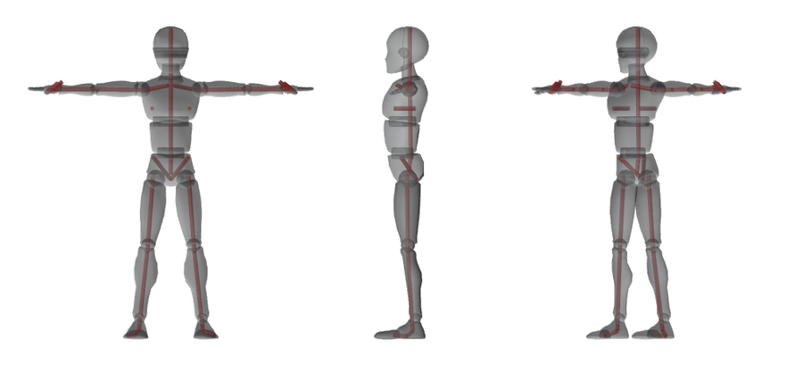
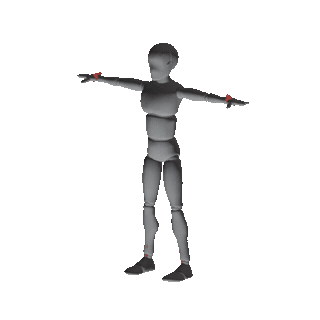

# bonewright

**Give it a character mesh (`.glb` / `.gltf`), get back a Blender rig you can animate** — Rigify controls,
skin weights on every vertex, and a pass/fail gate that tells you when the result should not be trusted.
Python drives the steps, `codex exec` judges, gates verify. [한국어](README.ko.md)

<p align="center">
  
</p>

## What it does for you

- **Rigs** humans and four-legged animals from a bare mesh (T- or A-pose), or reuses a skeleton the file already has.
  Sample results: [a capsule doll](examples/sample-output/capsule_doll.md) (73 deform bones) and
  [a four-legged capsule dog](examples/sample-output/capsule_dog.md) (110), both procedural.
- **Rigs anything else with limbs** (insects, monsters) as bone chains built from the mesh's own shape.
- **Refuses** meshes it cannot rig well instead of handing back a broken rig (`--force` overrides).
- **Retargets motion** — a BVH clip onto the new rig — and **exports** a game-ready GLB.

## Install

Needs Python 3 and Blender 5.2 LTS (or the `bpy` wheel). The CLI itself has no dependencies.

```bash
pip install .                 # or: pip install ".[headless]" to use the bpy wheel instead of Blender.app
bw doctor                     # checks that Blender and Rigify are reachable
```

## First run

```bash
bw rig character.glb          # rig it; results land in runs/<run-id>/ (report path printed)
bw demo <run-id>              # mp4/gif of the rig moving through its IK controls
bw export <run-id>            # deform-only GLB + skin, re-imported and checked
```

| your file | command |
|---|---|
| human or dog proportions, no skeleton | `bw rig x.glb` (add `--preset quadruped` for animals) |
| already has a skeleton | `bw rig x.glb --from-skeleton` (0 model tokens) |
| no skeleton and no preset fits | `bw rig x.glb --from-shape` |

A `bw rig` run makes two model calls (about $1). `BW_BACKEND=mock` or `--from-skeleton` costs zero tokens.

**Language.** `bw --help`, `bw doctor` and `BLOCKED:` error messages are in English (Korean with `BW_LANG=ko` or a
`ko_*` locale). So are the per-gate rejection reasons listed under a `BLOCKED:` line and the `bw rig` / `bw motion`
progress log, the analysis warnings and errors that come from inside the Blender scripts, and the `bw bench` table and
run reports. The [guide](docs/GUIDE.md#rejection-gate) explains the rejection gate in English.

**Settings.** To stop typing the same flags, put them in `runs/config.json` in your project folder, e.g.
`{"lang": "en", "rig": {"rest_pose": "t"}}` fixes the model prompt language and bakes a T-pose rest on every run.
Flags still win over the file. Keys and defaults: [guide → Settings](docs/GUIDE.md#settings-runsconfigjson).

## What you get

<table>
<tr><th width="50%">The rig moved by its own IK controls</th><th width="50%">The same rig receiving a BVH walk</th></tr>
<tr>
<td></td>
<td></td>
</tr>
</table>

`bw rig mannequiny.glb`: 7,136 verts → 410 bones (73 deform), every vertex weighted, all gates green.
On the benchmark, **63 / 66** assets rig with every gate green and **25 / 29** of the ones that can walk
retarget a walk cleanly (`python3 scripts/bench_score.py`).
To check retargeting yourself without any download, see [a sample retarget result](examples/sample-output/capsule_doll_motion.md)
(`python3 examples/rig_sample.py --motion`: a procedural 24-frame wave BVH, 18 of 19 joints mapped).

Status: **v0.2 (alpha)**. Developed on macOS; Linux runs the test suite in CI; Windows runs only the Blender-free tests in CI and has never been driven by hand.

## More

- **[Full guide](docs/GUIDE.md)** — every flag, how joints are found, the rejection gate, motion retargeting,
  the benchmark and what the numbers do and do not mean.
- [examples/](examples/README.md) — reproduce mesh → rig (bone count and names table) with zero tokens; see [a sample result](examples/sample-output/capsule_doll.md) first.
- [CHANGELOG.md](CHANGELOG.md) · [CONTRIBUTING.md](CONTRIBUTING.md) · [SECURITY.md](SECURITY.md)

## License

**MIT, except `bonewright/bpy_scripts/`, which is GPL-3.0-or-later** (code that `import bpy` is a derivative
work of Blender; `scripts/check_license_boundary.py` enforces the split in CI). Rendered images in
`docs/media/` come from other people's meshes (CC BY 4.0 and CC0) — see
[docs/media/ATTRIBUTION.md](docs/media/ATTRIBUTION.md). Details in the [guide](docs/GUIDE.md#license).
