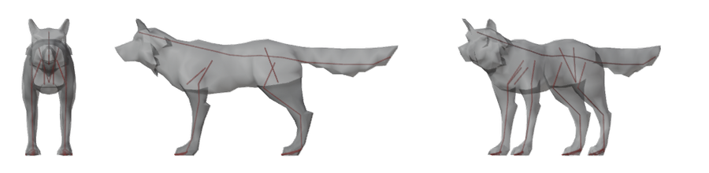
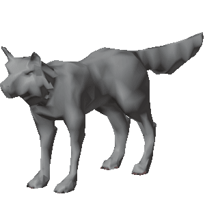

# bonewright — full guide

> Short version: [README.md](../README.md). This is the complete reference, moved out of the README unchanged apart from link paths.

Rig and animate Blender characters with Codex. **Python drives the steps, `codex exec` judges, gates verify.**

> **License: MIT, except `bonewright/bpy_scripts/`, which is GPL-3.0-or-later.** Anything that `import bpy` is a
> derivative work of Blender, so it has to be GPL; the MIT core reaches Blender only by launching it as a child
> process and exchanging JSON. `scripts/check_license_boundary.py` enforces that split in CI, so the boundary
> cannot rot. GitHub shows no license badge because it cannot read a repository with two — that is expected.

## What it produces

<p align="center">
  
</p>

<table>
<tr>
<th width="50%">The rig moved by its own IK controls</th>
<th width="50%">The same rig receiving a BVH walk</th>
</tr>
<tr>
<td></td>
<td></td>
</tr>
<tr>
<td><code>bw rig mannequiny.glb</code> → <code>bw demo &lt;run&gt;</code><br>
7,136 verts · 410 bones (73 deform) · every vertex weighted, no nearest-bone fallback ·
left/right weight difference 0.0002 · all gates green · Codex's own visual check: 0.86 confidence,
one flagged issue (finger bones grazing the silhouette)</td>
<td><code>bw motion --bvh walk.bvh --rig &lt;run&gt;</code><br>
18 of 30 source bones mapped (the unmapped 12 are spine sub-joints, jaw, eyes, finger tips and toe bases) ·
hands and feet land 9.91 cm from the source over all 60 frames · no frame puts a foot below the floor —
though they hover 6.4 cm higher than the source's do.<br>
<em>Read the direction error carefully.</em> The headline 5.08° is a mean over 12 bones of which six — both
arms — are exactly 0.00°, because arms are copied FK straight across. The error is all in the legs, which
use IK to absorb the proportion difference: thighs 11°, <strong>knees 19° (worst 31°)</strong>.<br>
<em>And the stretch figure is sampled.</em> Deformation is measured at 4 frames (1/20/40/60), not all 60:
the worst ratio is 5.17x at frame 60 (15 edges over 2x there), and the most edges over 2x is 20 at frame 40
(3.75x there). Out of 20,858 edges. The two numbers are from different frames.</td>
</tr>
</table>

Nothing here is a mock-up: both clips are the actual output of the commands under them, on the
`real2` / `walkviz` runs in this repository's history. The rig step was a real `codex exec` call
(86,274 tokens in, 1,518 out, 2 calls); everything else costs zero tokens. The walk clip fades
through white at the seam — the source BVH is a walk *with a wave*, which is not a cyclic clip, so
there is no frame pair that matches (the closest is 18.7° of average bone rotation apart, against
5.9° between neighbouring frames). A fade is honest about that; a crossfade would just ghost.

### Quadrupeds

<p align="center">
  
</p>

<p align="center">
  
</p>

`bw rig Wolf.gltf --preset quadruped` → `bw demo <run-id>`. 983 verts · 527 bones (110 deform) ·
every vertex weighted · left/right weight difference 0.0122 · all gates green.

**This one is the deterministic path** (`BW_BACKEND=mock`, `--no-judge`): **zero model tokens, no Codex
involved.** That is also how the quadruped benchmark number is produced — 5.6% mean joint error across
11 animals, and 3.2% on this wolf specifically (the worst, a cow, is 7.4%). Worth knowing what it does *not* give you: the neck
estimate failed on this mesh and fell back to human proportions. The tail is not a chain of its own —
it is the far end of the spine chain, three deform bones (`DEF-spine`, `.001`, `.002`, of length 0.37 /
0.58 / 0.73) spanning a tail 1.52 long, and `bw motion` maps a source `tail*` chain onto exactly those.
Three segments bend; they do not whip.


**Meshes are other people's work.** The human is *Mannequiny*, © 2020 GDQuest and contributors,
[CC BY 4.0](https://creativecommons.org/licenses/by/4.0/), via
[godotengine/godot-demo-projects](https://github.com/godotengine/godot-demo-projects/blob/master/3d/ragdoll_physics/characters/mannequiny.LICENSE.md);
those images are adaptations, since bonewright replaced the skeleton and the skin weights. The wolf is
from Quaternius, *Ultimate Animated Animals*, **CC0**. Neither mesh file is committed here — only the
renders. Full record: [docs/media/ATTRIBUTION.md](media/ATTRIBUTION.md).

## Where it stands

| What is measured | Score |
|---|---|
| **Rigging** — every gate green, no human review flagged | **63 / 66 = 95.5%** |
| **Motion** — a walk retargeted onto the rig, mesh stretch under 6x and under 1% of edges | **25 / 29 = 86.2%** |

Both numbers come from `python3 scripts/bench_score.py`, which picks neither the assets nor the path: it walks the
asset folder and tries the documented ladder (`--from-skeleton` → silhouette preset → `--from-shape`) in order.

**Read the second number with its denominator.** Of the 63 rigs that pass, **34 cannot receive motion at all** — a
chain rig built from a blob's own shape has bones named `Limb3_2`, which no BVH maps onto, and a human walk on a
blob is meaningless anyway. Those are excluded rather than counted as passes. An earlier version of this benchmark
did count them, and 32 assets scored a perfect 1.00x stretch by never moving.

**The rigging gates only look at a character standing still.** On 2026-09-19 four separate changes passed every gate
while making the actual deformation worse — the worst took one asset from 3.72x to 20.7x stretch. Each one was
caught by animating, not by the gates. If you touch weights, run the motion bench.

Status: **v0.2 (alpha).** Humanoid and quadruped Rigify presets. Developed on macOS with Blender 5.2 LTS and
Codex CLI 0.155. **Linux runs the whole test suite in CI** on every push (ubuntu-latest, `bpy` wheel, renders
off), but nobody has driven it interactively on a Linux desktop. **Windows is unsupported:**
the Windows CI job is removed. `bw` looks for Blender under
`Program Files\Blender Foundation\Blender X.Y\blender.exe`, but no rig has ever been built on Windows.

## Install

Blender 5.2 LTS (or the `bpy` wheel) does the work; the CLI is plain Python with no dependencies.

```bash
git clone https://github.com/choisam4u-creator/bonewright && cd bonewright
python3 -m venv .venv && source .venv/bin/activate   # Homebrew / Linux Python refuses a global pip install (PEP 668)
pip install .                 # or: pip install ".[headless]" to pull the bpy wheel instead of Blender.app
bw doctor                     # checks that Blender or bpy is found (either one) and marks what is optional
bw rig character.glb          # rig it; add --from-skeleton if the file already has one
```

Developed and locally validated on macOS with Blender 5.2 LTS and Codex CLI 0.155; CI uses two Linux jobs.
Everything except the `fit` and `judge` steps costs zero model tokens; `BW_BACKEND=mock` runs the whole pipeline
deterministically with no model calls at all, which is what the tests and the benchmark use. Only `mock` and
`codex` (the default when unset) are accepted: any other value, a typo such as `Mock` included, stops before any model
call instead of quietly falling back to the paid path.

## Which flag do I want?

| your file | command |
|---|---|
| human or dog proportions, no skeleton, T- or A-pose | `bw rig x.glb` (add `--preset quadruped` for animals) |
| already has a skeleton — robot, stylised, posed, anything | `bw rig x.glb --from-skeleton` |
| no skeleton and no preset fits — insect, monster, seated | `bw rig x.glb --from-shape` |
| the gate refused it and you disagree | `bw rig x.glb --force`, or edit `targets_draft.json` and pass `--targets` |

## License

**MIT, except `bonewright/bpy_scripts/`, which is GPL-3.0-or-later.** Those files `import bpy` and run inside
Blender, and the Blender Foundation's position is that such code is a derivative work of Blender. The MIT core
never imports a Blender module — `scripts/check_license_boundary.py` enforces that in CI — and reaches Blender
only by running it as a child process and reading back a JSON file. See `bonewright/bpy_scripts/README.md`.
This is a reading of a published position, not legal advice.

Benchmark assets are **not** in this repository. `scripts/fetch_bench_assets.py` downloads CC0 / CC-BY models
from their original hosts; each one's source and license is recorded in the ledger the script writes.

`docs/media/` is different, and mixed. The human renders (`rig-views.png`, `rig-ik.gif`,
`walk-retarget.gif`) are adaptations of a **CC BY 4.0** mesh (*Mannequiny*, © 2020 GDQuest and contributors),
so those images are CC BY 4.0. The wolf renders (`quad-views.png`, `quad-demo.gif`) come from a **CC0** mesh
and carry no such condition. Both are recorded in
[`docs/media/ATTRIBUTION.md`](media/ATTRIBUTION.md). Neither mesh file is committed — only the renders.

## What it does well, and what it does not

`bw bench` strips a character's original skeleton, re-rigs it, and measures joint positions against what the original
author built. **That "answer" is one artist's rig, not anatomical truth** — read it as regression detection rather than
an absolute score. The numbers below come from the deterministic path (`BW_BACKEND=mock`, 0 tokens); the Codex path is
verified end to end over the runs kept in this repository — `runs/real1`, `runs/real2` and `docs/internal/real3`–`real6`, `real8`, seven in all — but is not benchmarked per asset.

| Input | Joint error (% of height) | Verdict |
|---|---|---|
| Human-proportioned T-pose, skinned, arms out | **1.6 – 7.4%** | usable (GDQuest mannequiny 1.6%, Quaternius Adventurer 3.3%) — measured on the deterministic path; see the note below |
| Quadrupeds (`--preset quadruped`) | **5.6%** over 11 animals (wolf 3.2%, horse 3.5%, worst cow 7.4%) | usable for dogs/hoofed animals |
| Robots, stylised, animals **that ship with a skeleton** | joints taken from the file | `--from-skeleton`, 0 tokens, no silhouette guess |
| A robot with **no** skeleton, built from separate rigid parts | **7.7%** (RobotExpressive) | rigs normally — the parts themselves give the joints |
| A stylised character with no skeleton whose crotch or ankle only the **inside** of the mesh shows | **5.7%** (quat_pp_41j) | rigs normally — see below |
| Everything else with no skeleton | 11 – 56% | **rejected before any model call**, with an editable `targets_draft.json` |

Faces are off by default. Motion retargeting (BVH → rig → GLB) exists and is measured below.

### Known gaps and failed attempts

An English digest of the end of `docs/ROADMAP.md` (Korean, dated 2026-09-15 to 09-19). Every line below was measured
on the deterministic path; the linked ROADMAP section (in Korean) has the full tables. Read it before retrying any of these.

- **Gates only see a character standing still.** On 2026-09-19 three plausible changes passed every gate and made real
  deformation worse; all three surfaced only when a walk was retargeted. Weight changes must be measured *moving*.
- **Open hole — arm-to-torso leak on hollow meshes.** The last 3 of 66 assets that fail rigging (quat_pp_43j,
  robot_expressive, KayKit skeleton warrior) share it: an arm or pelvis bone reaches across an empty chest and takes rib
  vertices (11 / 94 sampled on the skeleton warrior; the original author's rig leaks 0). Geodesic trimming changed
  nothing (voxel dilation fills the thin walls too); splitting by part count failed because mannequiny has 60 parts.
  [ROADMAP: KayKit skeleton warrior leak](ROADMAP.md#막힌-곳-kaykit-해골-전사의-팔몸통-누수-2026-09-19-다섯-번째-실패)
- **Failed — deleting finger segments the source does not have.** Rabbit improved slightly (12.19 → 11.30x max edge
  stretch), godot_player went 1.87 → 8.46x and a KayKit mage stopped rigging. Reverted. [ROADMAP: deleting finger segments](ROADMAP.md#실패-원본에-없는-손가락-마디-지우기-2026-09-19)
- **Failed — copying the original author's weights by joint position.** Leak dropped to 0 / 94, but stretch went
  5.78 → 11.25x (skeleton warrior) and 3.72 → 20.71x (cesium_man): zero-length marker joints make "nearest position"
  meaningless. Needs those markers rebuilt as segments first. [ROADMAP: original weights by position](ROADMAP.md#실패-원작자의-가중치를-자리로-짝지어-가져오기-2026-09-19)
- **Replaced — trimming influences with one ray per vertex.** It fixed the hollow skeleton (11 → 0 leak) but on
  mannequiny, built from separate parts, stretch went 4.71 → 7.88x (87 edges over 2x vs 6): the way to a neighbouring
  part always leaves the shell. `rig.cross_trim` now measures voxel-geodesic distance instead and is on by default
  (`bonewright/bpy_scripts/_voxgeo.py` explains why). The 0.2.0 changelog first described the ray version; corrected.
- **Open hole — retargeting onto a `--from-shape` rig.** It runs (16 bones mapped on mannequiny) but tears: max stretch
  44x, 1,228 edges over 2x, against under 6x on the preset path, because the arm chain starts inside the chest. Two fixes
  failed (sphere thickness does not separate torso from limbs on low-poly meshes; dropping short chains also cut 2–4 of
  a scorpion's 10 legs). Use shape rigs for posing, weights and export, not motion. [ROADMAP: naming shape rigs](ROADMAP.md#모양-리그에-이름을-붙였다--되는-것과-안-되는-것-2026-09-19)
- **Partial — quadruped motion.** Wolf front legs and tails are not retargeted; a clip that leans forward the whole time
  loses the lean (the reference frame is the clip's most typical pose). [ROADMAP: animation, stage 3](ROADMAP.md#애니메이션-3단계--리타게팅-완료-2026-09-15)
- **Not built — partial meshes.** Upper-body-only meshes are rejected; there is no partial-rig route yet.

### Which backend produced these numbers

Every accuracy figure in this README comes from the **deterministic path** (`BW_BACKEND=mock`), which places joints
mechanically from the measured landmarks and costs nothing. The default path calls a model for the `fit` step. On
the one asset where both have been measured against the original rig, they now come out even:

| mannequiny, joints vs the author's rig | mean | worst |
|---|---|---|
| Model, before the fix below | 5.96 cm (3.3% of height) | 24.71 cm (foot) |
| **Model, now** | **3.06 cm (1.7%)** | 6.67 cm |
| Deterministic | 2.96 cm (1.6%) | 6.67 cm |

The first row is worth explaining, because the model was not the problem. It declined to place the shin and foot
and said why: the leg centreline it was given stopped at z=0.098 while the ankle is at z=0.049. That was true —
each centreline sample is a band's **centroid**, so the end sample sits half a band inside the real extremity, and
the foot was simply missing from its input. Declining was the right call; the damage came from what happened to an
unplaced bone, which kept its metarig default out in space.

Two changes followed. `landmarks.leg_tip_L/R` and `arm_tip_L/R` now carry the centroid of the actual toe and
fingertip slab, and the prompt points at them. Any bone the model still omits is filled in from the landmarks
rather than left at a default. The model went from placing 10 of 15 bones to **14 of 15** — the run's `fit.json` shows the last one, `spine`, came from the landmark fill, not from the model. So the two changes did different jobs: the tip data bought four more bones, and the fill covered the one the model still left out.

**This is one asset and two runs.** What it shows is that the model path is not worse; it does not show that paying
~86k input tokens buys anything over the free deterministic path on an ordinary human mesh.

## Rejection gate

The pipeline assumes a human body. When that assumption broke, the result used to come out silently wrong — a robot
came back with a rig off by 277% of its height. The mesh is now checked **before** the model is called, so a bad input
costs **zero tokens** (a rig otherwise costs ~80k input tokens).

A mesh is rejected when: an arm or leg centreline is missing on either side · a joint (crotch / hip / knee / ankle) had
to fall back to a body ratio · the head is over 35% of height (chibi) · left-right asymmetry exceeds 3% of height ·
size is outside 0.3–20 m. A neck-only fallback is a warning, not a rejection.

A rejection is not a dead end. The run directory keeps `targets_draft.json` — a starting point built from whatever
the mesh did give up — so you can drag the joints that are wrong and re-run with `--targets`, still at zero tokens.
If the file has a skeleton the message says so and points at `--from-skeleton` first.

**The bottom of a character almost always splits into two feet.** Clustering the lowest slice along X gives the foot
line even when nothing else can be traced. From there, a model built from separate rigid parts hands over the rest:
cluster the loose parts sitting on that foot line by height and the clusters *are* the ankle, knee and hip; the parts
on the centre line give the pelvis and the head; the part that reaches furthest out sideways is the hand, and its
height is the arm's. On RobotExpressive, whose legs read as a single column in silhouette:

| | measured | author's rig | of height |
|---|---|---|---|
| foot line (x) | 0.635 | 0.641 | 0.2% |
| ankle | 0.111 | 0.025 | 2.2% |
| knee | 0.900 | 0.935 | 0.9% |
| hip | 1.672 | 1.537 | 3.4% |
| pelvis | 1.312 | 1.344 | 0.8% |
| arm height | 2.473 | 2.439 | 0.9% |

The whole rig measures **30 cm, 7.7% of height** — down from 183 cm, and inside the band where the ordinary humanoid
path lands. One attempt failed and is worth recording: taking the *top* of the leg parts as the hip gives 2.07 m, because
the robot's skirt covers the leg line that high, and feeding that to the fitter made the benchmark worse.

Across the benchmark assets this separates **9 pass (1.6–7.7% error) from 7 rejected (11.0–55.8%)**, re-verified after
every change to the importer and the fitter. The honest miss that used to sit in this paragraph is gone: `quat_pp_41j`
was rejected at 6.3% of height because its crotch and ankle came from body ratios, and reading those two joints from
the inside of the mesh (next section) both let it through and improved it to 31.34 cm, **5.7%**. Override with `--force`.

The gate asks whether the joints rest on **evidence**, not on which evidence. A model built from separate rigid parts
has no traceable leg centreline, yet its parts are its articulation, so a full structural read (foot line, ankle, knee,
hip, arm height, at least six leg parts) satisfies the gate and carries a warning to look at the renders instead.
What gets rejected, and why, is worth knowing: two robots, an insect, a quadruped fed to the humanoid preset, a
character sitting in a furnished room, a 6 cm test cube, and three Khronos test rigs that have no limbs to find.

## No skeleton either? Build one from the shape

The rejection gate turns away a mesh whose joints cannot be read, and the inside read (below) only fills in gaps in a
human or quadruped reading. An insect, a seated girl, a fox fed to the wrong preset — none of those have joints to
find, so they were refused outright.

`--from-shape` builds the skeleton instead of looking for one. The inside read already finds every limb tip and the
path back to the body; resample each path into three segments, hang them off a body bone, and that *is* a skeleton.
The generic rig above then turns it into controls. Zero model calls.

```bash
bw rig scorpion.glb --from-shape     # 10 limbs, 31 bones, gates pass
```

Every asset the silhouette gate used to refuse now rigs this way — the insect, `kira` seated in her room, `fox` under
the humanoid preset, `godot_player`, and the three Khronos test shapes: bones inside the mesh, no unweighted vertices,
gates green.

**Read the limit before using it.** This is a *shape* rig, not an anatomical one. The bones follow the mesh, but the
joints sit at equal fractions of each limb, not at the knee and the elbow, and they are named `Limb3_2`, not
`thigh.L`. So motion retargeting, which matches bone names, does not apply — that still needs a preset or a real
skeleton. What you get is a rigged, deformable, poseable mesh for a body no preset describes.

## Anything with a skeleton: if it is a chain, it gets controls

A dragon has no legs. A ghost has no legs and a trailing body chain. A squid has tentacles. A blob has four bones
total. None of them fit the human or wolf metarig, and until now they were turned away with "no limbs found".

They are not turned away any more. When the source skeleton cannot be mapped onto a preset, the metarig is built by
**copying that skeleton bone for bone**: every bone gets `basic.super_copy` so it keeps a control and a deform bone,
and any run of bones already joined head-to-tail is promoted to `limbs.simple_tentacle` so it bends as one piece. No
joint names to recognise, no proportions to assume.

Two details make it hold up. Whether a bone deforms is decided by **the weights actually painted on it in the source**,
not by a flag — glTF marks every joint deformable, which would drag an organisational `Root` bone at the origin into
the rig and flag it as a bone outside the mesh. And the weights are not recomputed: the deform bones are named
`DEF-<source name>`, a one-to-one match, so the original weights are carried straight over. Bone Heat left 39% of
`orc_blob` unpainted (464 of 1203 vertices); the source had all of them.

Measured on 43 CC0 creatures (Quaternius *Ultimate Monsters* 40, KayKit *Skeletons* 3) — wings, tentacles, no legs,
four-bone blobs:

| | before | after |
|---|---|---|
| rigged | 14 / 43 | **43 / 43** |
| clean | 7 | **40** |
| needs a human look | 7 | 3 |
| refused | 29 | **0** |

The three that still want a look: an orc whose weapon island leaves 121 vertices to be filled, and two KayKit
skeletons whose arm weights leak through the gap between the ribs. Both are exactly what `needs_review` is for.

Three bugs surfaced on the way, all found by the new assets. A **held prop** — a trident, a weapon, a carrot — ships
as its own skinned mesh and was being merged into the body, moving the centre line by 2.5 m; a mesh whose weight is
over 90% on hand and finger bones is now treated as held, kept in the skinning and dropped from every size and centre
measurement. **Left-right repair** now fires whenever the source rig is symmetric, since any asymmetry left in ours is
then ours to fix, and it averages the two sides instead of copying one onto the other — copying pushed the repaired
side out through the mesh on a slightly asymmetric model. And **source symmetry is measured about the source rig's own
centre line**, not about x=0: an armature sitting 2 cm off the mesh centre was reporting that offset as 4 cm of
asymmetry, inflating the gate's tolerance so our own errors slipped under it.

## When the outline says nothing, read the inside

Silhouette bands slice the body by height and measure width. That works on a T-posed human and fails on everything
else: arms held against the body merge into the torso, a seated figure has no vertical leg column, and a stylised
character has no human proportions to fall back on.

So when a limb cannot be traced from the outside, the mesh is read from the **inside** instead. Rays down each grid
column fill the volume with voxels, a distance transform says how deep each voxel sits, and maximal spheres packed
from the deepest voxels outward trace the body's centre. Link the overlapping spheres, walk out from the middle, and
the farthest points *are* the fingertips, toes, head and tail — with the path back to the body attached to each one.

**What this gives, and what it does not.** Tips were found on all ten assets tried; on the six checked against the
authors' own rigs they land within 1–4% of height, whatever the pose or the proportions. Interior joints do not: a torso's medial axis is a *sheet*, not a
curve, so each limb's path crosses it by a different route. Taking the point where the two leg paths meet as the
pelvis was off by 18 cm on `godot_player` (0.81 m against a true 0.63 m), so that value is not produced at all. What
the inside read supplies is limited to what it actually measures:

| supplied | how | measured |
|---|---|---|
| arm centreline | the part of the hand's path outside the torso half-width | `kira` wrist 4.1%, hand 3.0% of height |
| crotch | the height where the two leg paths first touch | `mannequiny` 0.915 against a true hip of 0.926 — 1.1 cm |
| ankle | the corner where the leg path turns into the foot | `quat_pp_41j` 0.207 against a true 0.201 — 0.6 cm |
| four paws | quadruped tips clustered front/hind, head told from tail by path thickness | wolf, fox, horse all four |

The read only runs when the silhouette came up short, so the assets that already passed are untouched — and it costs
no model call either way.

**A read that disagrees with itself is not evidence.** On `godot_player` the reader grabbed a shoulder pauldron as one
hand, putting the two hands at 0.73 m and 1.96 m. Filling in an ankle from that and waving the mesh through would have
shipped a rig off by 18% of height with no warning. So the values are only allowed to clear a blocking gate when the
read is mirror-consistent — both feet and both hands present and matching within 5% of height. An inconsistent read
still improves `targets_draft.json`; it just does not buy a pass. A genuinely posed character fails this check, which
is the right answer: it fails the left-right gate anyway.

## Already rigged? Use its own skeleton

The rejection gate above turns away anything the silhouette cannot read — robots, stylised characters, animals in a
pose. Most of those files are not unrigged: the author already placed the joints. `--from-skeleton` reads that
skeleton and maps it onto the Rigify metarig, so you get the **controls** (IK/FK, motion retargeting, deform-only
export) without guessing at anatomy, and without a model call.

```bash
bw rig robot.glb --from-skeleton              # 0 tokens, silhouette gate skipped
bw rig wolf.gltf --preset quadruped --from-skeleton
```

Name conventions are the same dictionary the benchmark uses. Six are covered end to end and held by a test: Mixamo,
the Unreal mannequin, Unity Humanoid, DAZ Genesis, Character Creator, and a file that was already rigged with Rigify.
DAZ glues the side letter straight onto the name (`lShldr`), which is only safe to strip when what remains is a joint
name we know — `leg` must not become `eg`. Verified on `.glb`, `.gltf` and `.fbx`: the same character exported as FBX
rigs to the same result and passes the same gates. Beyond straight
name matching it handles what real files actually do wrong:

- **Sides come from coordinates, not names.** Importing flips many files 180°, which puts the author's `Left` bone on
  our −X. Trusting the name crosses the arms.
- **Chain ends missing.** Some rigs stop at the elbow and let one bone run to the foot (Quaternius animals), or have
  no wrist at all (three.js RobotExpressive stops at `Palm`). The previous bone's *tail* is that joint.
- **Curved chains.** The back and tail of an animal are not straight lines, so the spine is resampled along the source
  chain's own path rather than interpolated end to end. Rigify also requires the tail chain to start exactly where the
  pelvis does; otherwise generation fails outright with `Cannot connect chain - disjoint`.
- **Half-rigged files.** If only one side exists it is mirrored about the skeleton's own midline — not about x = 0,
  which is wrong when the file bundles a chair or a prop and shifts the mesh centre.
- **A missing limb is refused.** If both legs (or both arms) are absent there is nothing to infer from, and the run
  stops at 0 tokens rather than leaving those bones at metarig defaults, poking through the mesh.

Run over every benchmark asset (25 files, 0 tokens):

| Preset | Gates pass | Needs review | Refused at 0 tokens |
|---|---|---|---|
| Quadruped (10 animals) | **8** — wolf, horse, cow, bull, deer, donkey, husky, stag | 2 — alpaca, shiba inu (one bone of 110 outside) | 0 |
| Humanoid (15 files) | **8** | 2 — robot, chibi (arm weight reaching the chest centre) | 5 — insect, upper-body-only, two limbless test rigs, an animal fed to the humanoid preset |

Cow and bull are worth singling out: they are the two worst assets for the silhouette path (7.4%), because a thick
body breaks the hip-over-back ratio. Reading their own skeleton sidesteps the ratio entirely.

Vertices that automatic weighting leaves empty are filled **from their connected neighbours** — the weights of the nearest
vertex reachable along the mesh — rather than from the nearest bone. A nearest-bone guess makes a single vertex
follow a different bone than the flesh around it, and the shell cracks there; copying a neighbour's weights is
interpolation and moves with the surrounding surface. Only an island with no weighted vertex at all falls back to
the nearest bone, and that still counts as a hole.

A model built from separate parts gets one more thing: when automatic weights leave a **whole** disconnected island
empty, that island is bound to a single nearest bone rather than filled vertex by vertex. That is what a rigid part
wants — the robot's 40 stray vertices and the chibi's 130 (a head modelled as its own mesh) stop counting as holes,
because they are not holes. An island that is only *partly* empty is still a hole and still counted.

`needs_review` here is usually the asset, not the rig. The robot's arms and legs are floating boxes with real gaps, so
some bones legitimately cross empty space; those are now counted separately from bones that stick out of the body,
because a bone bridging a gap still skins correctly while a bone with a loose end does not.

## Install and run

```bash
pip install .            # installs `bw` (inside the venv from Install above)
bw doctor                # Blender (app or bpy wheel), Codex login, kimodo.cpp (optional)
bw rig character.glb --preset humanoid
bw rig already_rigged.glb --from-skeleton   # use the file's own skeleton, no model call (0 tokens)
bw motion --text "a person walks forward, stops and waves"   # needs kimodo.cpp (Apple Silicon: Metal)
bw motion --bvh walk.bvh --rig <run-id> --export         # retarget a BVH onto a rig, export deform-only GLB (0 tokens)
bw demo <run-id>         # mp4/gif of the rig moving through IK controls (0 tokens)
bw export <run-id>       # game-ready GLB: deform bones only (73, not 410) + skin, re-imported and checked (0 tokens)
bw bench a.glb b.glb     # compare against the original skeletons (0 tokens)
bw status                # every run under runs/: step, status, input tokens
bw status <run-id>       # one run: its report, the files it made, and (for a rig) the commands not yet run
```

Each run lives in `runs/<run-id>/` (`report.md`, `targets.json`, the `.blend` files, `logs/`). The id defaults to
`rig-<date>-<time>`; `--run-id` takes letters, digits and `. _ -` only (no `/`, `\` or `..`, so a run never lands
outside `runs/`). Giving the id of a finished rig replaces it, and the old rig's `rigged.glb` and demo video are
removed so they never sit beside the new rig. `bw status` lists them
one per line with its kind (rig, motion or bench) — `rig-20261010-101500: rig · final ok · input tokens 81,234`. A run that failed or was stopped by the budget
or a usage limit ends with `→ why: bw doctor --for-issue <run-id>`, which shows its state and the end of its log. A run that
stopped on a `BLOCKED:` message instead repeats that message there, with its next command (`BW_NO_RENDER=1 bw motion …`);
so does a rejected rig (`fit rejected`, `preflight rejected`: the reasons, the `--targets` draft command, `--force`).
A rig that finished as `needs_review` (both at the end of `bw rig`, before its `next:` line, and in `bw status`) names its first failed check and the 0-token rerun from its `targets.json`
(`bw rig <mesh> --preset <preset> --targets runs/<id>/targets.json`).
`bw export` and `bw demo` record their own `export_state.json` / `demo_state.json`, so a failed export never turns a
finished rig into a failed one.

Cost: one `bw rig` makes **2 model calls** — a fit call (~80k input tokens) and a visual judge call (2 images).
Measured runs landed at **$0.86 – $1.10** each. `bw usage` prints the ledger. A rejected mesh costs nothing, and
`--no-judge` skips the second call.

When a command stops with `BLOCKED:`, the line starting with `→` says what to change. For an error it did not
expect, it also prints the run's `logs/` folder (one Blender log per step); prefix the command with `BW_DEBUG=1`
to get the full Python traceback for an issue report. `bw doctor --for-issue <run-id>` gathers the versions, your
`runs/config.json` (with any unknown keys named), the run's `state.json` and the tail of its last log into one block to paste into the issue, with home paths replaced by `~`.

On a machine with no display (a headless Linux server, WSL, a container), Blender's renderer cannot start (the log shows
`Couldn't open libEGL.so.1`). The rig is already saved by then; `bw` says so and gives the same command with
`BW_NO_RENDER=1` in front, which skips the pictures (and with them the visual judge). `bw demo` needs the pictures, so it
needs EGL (`sudo apt install libegl1` on Debian/Ubuntu) or a machine with a display.

A-pose input rigs as well as T-pose. `--rest-pose t` bakes a T-pose rest, which downstream animation usually expects.
Measured on one asset posed at several arm angles, against its own original T-pose skeleton:

| Arms lowered | Joint error | How it is handled |
|---|---|---|
| 30° / 45° | 2.74 / 2.62 cm (1.5%) | arms swung after fitting, using the fitted metarig |
| 60° | 3.19 cm (1.8%) | mesh straightened **before** analysis, then re-measured |
| 75° | 6.12 cm (3.4%) | same (was 10.19 cm when analysed in the A-pose) |
| 90° (arms flat against the body) | — | **rejected**: no arm centreline can be found, so nothing can be straightened |

Below 50° the arms are swung after fitting; above it the mesh is straightened first, because an arm lying against the
torso makes joint detection unreliable. Characters whose "T" already droops a few degrees are left alone (8°).

```bash
bw rig character_apose.glb --rest-pose t     # rest pose becomes T (arms horizontal); default keeps the mesh's own pose
```

When a joint lands wrong, fix it by hand instead of paying for another run:

```bash
bw rig character.glb --pin "spine.004=0,0,1.42"            # pin a joint; pins beat every automatic correction
bw rig character.glb --targets runs/<id>/targets.json      # re-run with edited targets, 0 model calls, 0 tokens
bw rig character.glb --targets runs/<id>/targets.json --pin "shin.L=0.09,0,0.48"
```

Weights get one cleanup pass before the 4-influence trim: a bone more than 2.5× farther from a vertex than that
vertex's nearest deform bone is dropped from it. Automatic weights hand arm bones a share of chest-centre vertices on
bodies whose shoulders sit close in; a natural blend at an elbow or shoulder keeps both bones because their distances
are comparable. Measured effect on skinning agreement with the original rigs: mannequiny 0.600 → 0.605, cesium_man
side agreement 0.997 → 0.998, Quaternius Adventurer unchanged.

### Settings (`runs/config.json`)

Every setting has a built-in default; `runs/config.json` in the project folder (`BW_HOME` if set, else the nearest
folder upward that holds `bonewright/` or `runs/`, falling back to the current folder if neither is found)
overrides only the keys it names, section by section. A file that is not valid JSON stops with `BLOCKED:` naming the line and
column; so does a value of the wrong type (a string where a number goes) or one the matching flag would refuse
(`"lang": "fr"`, `"rest_pose": "T"`), each listed with what is expected. An unknown key (usually a typo) only warns.
`bw doctor` reports any of these as one `[settings]` line and checks everything else. The keys you are most likely to change:

| Key | Default | What it does |
|---|---|---|
| `lang` | `""` | language of the model prompts (`ko` or `en`); empty follows the screen language |
| `rig.rest_pose` | `"keep"` | `keep` the mesh's own pose, or `t` to bake a T-pose rest (same as `--rest-pose`) |
| `rig.weights` | `"auto"` | `auto` (Bone Heat, voxel proxy if it leaves gaps) or `proxy` (same as `--weights`) |
| `rig.cross_trim` | `true` | drop weights that reach across empty space from another body part |
| `rig.face` | `false` | keep the metarig's face bones |
| `blender.app` | `""` | path to the Blender executable; empty searches `BW_BLENDER`, `PATH`, then the usual install folders |
| `blender.timeout` | `600` | seconds one Blender step may run |
| `budget.max_input_tokens` | `600000` | a run stops once its input tokens reach this (same as `--budget`) |
| `render.size` | `512` | pixel size of the review renders |
| `kimodo.root` | `"vendor/kimodo.cpp"` | where the kimodo.cpp build lives (see below) |

The prompt language is picked in this order: `bw rig --lang`, then `lang` here, then `BW_LANG`, then the system
locale. Command-line flags always beat the file. For example:

```json
{"lang": "en", "rig": {"rest_pose": "t"}, "blender": {"app": "/opt/blender-5.2/blender"}}
```

### Text → motion: building kimodo.cpp (optional)

Only `bw motion --text` needs this. `bw rig`, `bw export`, `bw demo` and `bw motion --bvh` never touch it, and
`bw doctor` lists it as optional. [kimodo.cpp](https://github.com/localai-org/kimodo.cpp) is a C++/GGML port of
NVIDIA's Kimodo text-to-motion model (code Apache-2.0). It is not vendored: the build plus weights take about 15 GB.

bonewright looks for three things under `vendor/kimodo.cpp/` in the repository (the `vendor/` folder is git-ignored):

| What | Path under `vendor/kimodo.cpp/` | Config key |
|---|---|---|
| generator binary | `build/release/kmd-generate` (or `build-release/kmd-generate`, from older builds) | (searched under `root`) |
| motion model | `models/kimodo-soma-rp-v1.1-f32.gguf` | `kimodo.model` |
| text encoder | `kimodo.text_bundle` if it exists (default `generated/llm2vec-text-bundle`, the older component folder); otherwise the single text GGUF the downloader installs next to `tokenizer.gguf` (Q8_0 preferred) | `kimodo.text_bundle` |

With the current upstream on macOS (Apple Silicon, Metal backend; needs `cmake`, `ninja` and the Hugging Face `hf` CLI).
The September 2026 Mac build used an older layout (`build-release/`, a text component folder); both are accepted:

```bash
git clone https://github.com/localai-org/kimodo.cpp vendor/kimodo.cpp
cd vendor/kimodo.cpp && git submodule update --init --recursive
cmake --preset release -DKIMODO_ENABLE_VULKAN=OFF     # macOS: Vulkan off, Metal on
cmake --build --preset release                        # → build/release/kmd-generate
scripts/download_gguf_weights.sh --output "$PWD" --model soma-rp-v1.1   # motion model + Q8_0 text encoder + tokenizer.gguf
```

Follow the kimodo.cpp README if its presets or script options have changed since; what matters to bonewright is
only that the three things above can be found. To keep the build elsewhere, put `{"kimodo": {"root": "/path/to/kimodo.cpp"}}`
in `runs/config.json`. Then `bw doctor` reports `kimodo.cpp: built`.

Measured on an M4 Pro: 60 frames (2 s at 30 fps) in 46.5 s, 3.8 GB of memory. Weights keep their own
licence: the SOMA RP v1.1 model used here is under the NVIDIA Open Model License (commercial use allowed); the
SMPL-X variant is not, so bonewright does not use it. Without kimodo.cpp, any BVH works: `bw motion --bvh walk.bvh`.

## Motion retargeting
### When the rig has no anatomical names

Retargeting matches bone **names**, so a rig built from a mesh's own shape — whose bones are called `Limb3_2` —
matches nothing in a BVH and receives no motion at all. Of the 66 benchmark assets, 63 rig successfully but **34 of
those cannot take a walk**, which the score reports as unmeasurable rather than as a pass.

`--map` lets you write the correspondence yourself:

```bash
echo '{"LeftArm": "Limb3_2", "LeftForeArm": "Limb3_3"}' > bones.json
bw motion --bvh walk.bvh --rig my_blob --map bones.json
```

It overrides the automatic matching per entry, leaves the rest alone, and tells you how many names it could not
find in the BVH instead of silently ignoring a typo — with the closest BVH bone name and the file fixed to use it,
or the file swapped if keys and values look reversed. A rig bone that is not in the rig is reported the same way, with the nearest control: rig
names are control names, so a humanoid arm is `upper_arm_fk.L`, not the metarig's `upper_arm.L`. Matching by **position** rather than by hand was tried for
weights and failed badly (see ROADMAP), so this stays manual for now.

A word of warning from testing it: mapping a human shoulder onto a blob's tentacle does apply, and made the mesh
stretch worse (8.24x → 14.26x). The option gives you the controls; it cannot tell you that your mapping is sensible.


`bw motion --bvh file.bvh --rig <run-id> [--export]` moves a BVH clip onto a rig made by `bw rig`
(the rig's preset is read from its run; `--preset` overrides). BVH joints are matched to Rigify controls by name (kimodo `LeftLeg/LeftShin`, Mixamo
`LeftUpLeg/LeftLeg`, CMU and Quaternius animal `BackLeg/FrontUpperLeg` conventions are covered by tests or runs).
Units and frame rate are taken from the file (CMU's 16.7-unit hip height becomes a 0.06 scale); zero-length joints
(CMU hands) take their direction from the first non-thumb child bone.

Which joint drives which control (humanoid preset; the right side is the same with `Right`/`.R`; a `mixamorig:`
prefix is ignored):

| Rig control | Mixamo-style names | kimodo-style names | joint-named (SMPL, pose estimators) |
|---|---|---|---|
| `torso` (root motion too) | `Hips` | `Hips` | `Pelvis` |
| `chest` | `Spine2` | `Chest` | `Spine3` |
| `neck` | `Neck` | `Neck1` | `Neck` |
| `head` | `Head` | `Head` | `Head` |
| `shoulder.L` | `LeftShoulder` | `LeftShoulder` | `L_Collar` |
| `upper_arm_fk.L` | `LeftArm` | `LeftArm` | `L_Shoulder` |
| `forearm_fk.L` | `LeftForeArm` | `LeftForeArm` | `L_Elbow` |
| `hand_fk.L` | `LeftHand` | `LeftHand` | `L_Wrist` |
| `thigh_fk.L` | `LeftUpLeg` | `LeftLeg` | `L_Hip` |
| `shin_fk.L` | `LeftLeg` | `LeftShin` | `L_Knee` |
| `foot_fk.L` | `LeftFoot` | `LeftFoot` | `L_Ankle` |
| not moved | `Spine`, `Spine1`, `LeftToeBase` | `Spine1`, `Spine2`, `Neck2`, `Jaw`, `LeftEye`, `LeftToeBase` | `Spine1`, `Spine2`, `L_Foot` |

The **mid spine is not moved on purpose**: the Rigify torso has one FK `chest` control above the hips, so the joint
called `Chest` — or, without one, the highest-numbered `Spine`/`Torso` joint — drives it, and the joints in between
are skipped. `LeftLeg` means the thigh when the same side also has a `Shin`, and the shin otherwise. A BVH joint turns the bone that
starts at it, so when a side has a `Knee` or `Elbow` joint, `Hip` is the thigh and `Shoulder` the upper arm (the
pelvis and Mixamo's `LeftShoulder` collarbone are unaffected). Biovision names (`LeftCollar`, `LeftUpArm`, `LeftLowArm`,
`LeftLowLeg`) map the same way as their Mixamo counterparts. So "unmapped
['Spine']" in `report.md` is expected, not a failure. Anything else unmapped can be added with `--map`
(above); when an arm or leg control ends up with no BVH bone at all, `bw motion` names those controls and
the unrecognised bones and gives the `--map` command. `tests/test_docs.py` checks this table against the matching code.

The **up axis is detected** from the file, because getting it wrong fails silently rather than loudly: the standard
says Y, Blender exports Z, and feeding a Z-up clip as Y-up moved the wolf's feet a metre off the floor while every
step still ran to completion (bone direction error 2.8° → 14.9°). Detection reads the rest hierarchy and picks the
axis on which the head sits above the feet; with no recognisable head or feet it falls back to the standard Y.
`--bvh-up y|z` overrides it.

- **Arms, body:** each bone receives the source joint's world rotation delta. Limbs get a rest-pose correction (a
  common reference frame built from the bone direction and world forward), so an A-pose rig receives the same motion
  as a T-pose rig (0.2 cm difference) and twist comes along. Spine, neck and head take their reference from the
  clip's most typical frame instead of the bind pose — animal rigs are often bound with the head raised, and a pure
  bind-pose delta then makes the character stare at the ground.
- **Tail (quadrupeds):** the wolf metarig's tail chain is numbered backwards from the pelvis (`spine.003` → `spine`),
  and source rigs carry anywhere from two to eight tail joints, so they are spread evenly over the four controls.
  Without this every `Tail*` joint collided on one control and the tail stayed frozen.
  A four-legged rig wants a four-legged clip: a standing (human) BVH on it — the sample `wave.bvh` included — drives
  the front legs with the arms, and `bw motion` says so with the same command on your latest human rig.
  The other way round — a four-legged BVH (head
  in front of the hips, front paws on the floor) on a human rig — the front legs would drive the arms and the tail is
  dropped, so `bw motion` says so with the same command on your latest four-legged rig or with the hand wave.
- **Legs (`--legs auto`, default):** legs whose source chain ends at a foot tip are driven by Rigify's foot IK: the
  tip follows the BVH tip relative to the hip, scaled by the leg-length ratio, with the clip's lowest foot point taken
  as the floor. Legs whose source chain stops at the wrist (the Quaternius wolf's front legs — the paw is a detached
  IK bone) stay FK. `--legs fk` transfers rotations only.
- Root motion goes to `torso`, scaled by the hip-height ratio. `--bvh-up z` reads BVH files written by Blender itself.

Measured (`BW_BACKEND=mock`, 0 tokens):

| Clip → rig | Hands vs BVH (hip-relative) | Feet: lowest toe / floor · slide during BVH stance | Edge stretch |
|---|---|---|---|
| kimodo walk+wave → mannequiny T rest | 12.0 / 14.1 cm | −0.4 cm · 9.9 cm (BVH itself 8.6) | max 4.8× (a few 2–20 mm edges) |
| same → mannequiny **A-pose rest** | 10.6 / 11.9 cm | −0.9 cm · 9.7 cm | max 3.8× |
| same → Quaternius Adventurer | 13.8 / 13.1 cm | +4.1 cm (FK) | max 2.9× |
| Quaternius wolf Walk → our wolf rig | — | 0.05 cm · 0.7 cm (BVH 0.8) | max 2.6× |
| Quaternius wolf Gallop → our wolf rig | — | 0.0 cm · — | max 2.6× |
| CMU mocap 02_01 walk (120 fps, non-metric units, zero-length hand joints) → mannequiny | 14.9 / 17.9 cm | −0.6 cm · 76.6 cm over 344 frames (BVH 76.5) | max 3.6× |

Hand position error is bounded by proportion differences between the BVH skeleton and the character, not by the
transfer. Every run renders four frames next to the BVH skeleton drawn in red; the wolf walk was also compared frame
by frame against the original Quaternius animation from the side. Remaining gaps: the wolf's front legs are FK only
and its thigh is 1.4× the source's, so front paws swing wider than the original; the tail is not transferred.

`--export` writes `runs/<id>/animated.glb` with **deform bones only** (73 instead of 410 for a Rigify human), the
animation baked; the file is re-imported and hand/foot positions checked at the middle frame (0.0 cm difference).
`bw motion --text "..." --rig <run-id> --export` runs the whole chain text → kimodo.cpp → BVH → rig → GLB (60 frames
in ~50 s on an M4 Pro; kimodo.cpp must be built with `-DKIMODO_ENABLE_VULKAN=OFF` on macOS).

The edge-stretch check caught a real bug: vertices that Bone Heat leaves unweighted (152 hand-tip vertices on the
A-pose mannequiny) stayed at their rest position while the character walked away, turning into 2 m rods. Unweighted
vertices are now bound to the nearest deform bone, and the gate counts filled holes.

## What counts as "the character" in a file

Game files are rarely one clean mesh. When the file has an armature, bonewright takes the skinned meshes **plus parts
rigidly parented to bones** (a robot's arm and head, a low-poly character's separate head), and drops everything else:
furniture and walls in a scene export, the 42-vertex probe sphere many exporters leave at the origin, and anything
parented to a hand or finger bone (weapons, tools). An attached part is treated as **decoration** when the skinned mesh
already has geometry around its bone (antlers, shoulder armour, a separate head on a body that already has a neck):
it is skinned but ignored when locating joints and measuring height — a stag's antlers would otherwise add 30% to its
height and push every leg joint. A part whose bone region is empty in the skinned mesh (a robot's arms and legs) is
structural and takes part in everything. Files without an armature are used whole.

## Which way the character faces

Importing has to put the character upright, on the floor, facing −Y, with left at +X. Front-to-back is read from the
mesh (feet point forward; for quadrupeds the head decides). **Left-to-right cannot be read from a silhouette** — a
T-pose's arm span and a body's depth are both just "the wide axis". When the file has a skeleton, the answer is in it:
the axis on which left/right bone pairs are furthest apart is the lateral one, and if that is Y the character is
turned 90°. One benchmark asset was built this way and had been rigged sideways ever since — bones crossed in an X
through the legs, 89 cm mean joint error, the worst asset in the set. With the turn corrected it passes every gate.

## How joints are found

Landmarks come from mesh evidence, not from human body ratios: the crotch is the top of the run of bands where the
silhouette splits left/right, the neck is the narrowest band under the head, the ankle is the top of the foot blob
(the part sticking out in Y), the knee is refined from the leg centreline. Height ratios remain only as last-resort
fallbacks and every use is reported in `landmarks.ratio_fallbacks`, with `landmarks.suspect` listing why a result may
be wrong. Inside/outside tests run against a voxel-remeshed volume copy, because game meshes are overlapping shells
with holes.

Quadrupeds use a separate path. The four foot positions and two more things are measured from the mesh: the **back
height** above each leg (hip = 0.80 of it, shoulder = 0.635, both ±0.06 across the 11 reference animals — twice as
consistent as any ratio of total height) and the **front leg's backward lean**, which splits dog-type legs (lean
0.089–0.133, elbow high at 24% of the leg) from hoofed ones (−0.05–0.066, elbow at 50%) with no overlap. Joints in
between are placed at ratios measured from the reference rigs — the knee at 27.4% ± 1.9 of hip-to-toe is the most
consistent quantity in the whole dataset. What is *not* measured is the pelvis bone's height: reference rigs put it
anywhere from 0.44 to 0.88 of body height, so that part is convention, not anatomy.

`bw rig` = analyze mesh (0 tokens) → **rejection gate (0 tokens)** → Codex proposes metarig bone targets (1 call) →
Rigify generate + automatic weights → gates (unweighted vertices, weight sums, symmetry, bones outside the mesh box) →
3 test renders → Codex looks at 2 of them (1 call, ~18k input tokens each) → `runs/<id>/report.md`.

## Reproducing the benchmark

Benchmark assets are not committed. Most of them are CC0 and could legally be vendored — the reasons are practical: 30 MB of quadrupeds alone, and every file would drag its own attribution obligations into this repository. Fetch them from the original hosts instead:

```bash
python3 scripts/fetch_bench_assets.py --out bench-assets
bw bench bench-assets/quadruped/*.gltf --preset quadruped
bw bench bench-assets/samples/*.glb --skin     # also compare skin weights against the original author's
```

**The script fetches 62 of the 66.** Ten quadrupeds, 4 Khronos samples, 40 Quaternius monsters, 3 KayKit
skeletons, and 5 characters (`mannequiny`, `godot_player`, `robot_expressive`, `rigged_mesh`, `quaternius_ual`)
— each from its original host, each with its own licence recorded in the ledger the script writes.

**Four are still missing:** `kira`, `alien_bug`, `quat_pp_41j`, `quat_pp_43j`. Their download URLs were never
written down. Six poly.pizza candidates were fetched and tested on 2026-09-20 and **all six were ruled out** —
the closest, a 41-bone Quaternius character, has its arms 0.33 of its height out where the missing one has 0.43.
Until the real files turn up, a fetch-and-score run covers 62 assets, not 66, and will not produce the 63 / 66
quoted above.

Identifying a candidate takes a minute: [`docs/bench-unresolved-fingerprints.json`](bench-unresolved-fingerprints.json)
holds each missing asset's **source bone count** and its author-placed joints as fractions of height, plus the
candidates already rejected and why. Run `bw bench candidate.glb` and compare. The bone count rejects most
candidates outright; the joint ratios settle the rest, because the five assets that *were* recovered matched
theirs to the decimal while every near-miss sat 7–58% off. Height and error are weaker fingerprints — they move
when the importer changes, as `robot_expressive` did (0.8602 m → 3.9348 m).

One thing that search did settle: `quat_pp_41j` is the asset described under [Which way the character
faces](#which-way-the-character-faces) — the one built on a swapped lateral axis and rigged sideways for months.
Its 2026-09-15 record has the arms running along Y while every other asset's run along X, and its mean error there
was 88.69 cm, which is the "89 cm" in that section.

The five that *were* recovered are the same files, not lookalikes: re-benching them reproduces the recorded
height and joint count exactly — `godot_player` 2.1184 m / 13 joints, `quaternius_ual` 1.8287 m / 17 joints /
13.54 cm mean, `rigged_mesh` 0.0603 m / 3 joints, `mannequiny` 1.7979 m / 2.96 cm, `robot_expressive` 3.9348 m.

`--skin` reports, per asset and **per body region**, the distance between the "influence centres" of the two weight
sets (name-free), plus the weaker name-agreement number. Current baseline: mannequiny 4.1 cm (2.3% of height),
Quaternius UAL 9.2 cm (5.0%), cesium_man 10.6 cm (7.0%). Read these as a floor, not a score: reference rigs that draw
every bone as a zero-length marker at the joint (the whole Quaternius family) make any distance-to-bone measure
pessimistic, and one of them parents the foot to the root rather than the shin, which no reconstruction can repair.

Weights themselves are engine-ready: automatic weighting binds up to 9–10 bones to a single vertex, which glTF and
most engines silently truncate to 4, so bonewright keeps the largest 4 and renormalises (measured cost: 0.05 cm).

### The completion score

`scripts/bench_score.py` reports one number for the whole asset set, and it picks neither the assets nor the path.
It walks the folder, and for each file it tries the documented ladder in order — `--from-skeleton`, then the
silhouette preset, then `--from-shape` — and counts the asset as passing only if some rung reaches `ok` (every gate
green, no human review flagged).

```bash
python3 scripts/bench_score.py --assets bench-assets --home /tmp/bwscore --out score.txt
```

Give it a BVH and it also **animates every rig that passed** and measures how far the mesh stretches, which is the
only way to catch a weight change that keeps the gates green while making the deformation worse:

```bash
python3 scripts/bench_score.py --assets bench-assets --home /tmp/bwscore \
    --motion-humanoid walk.bvh --motion-quad wolf_walk.bvh
```

Stretch is judged on **depth and breadth**, because the single worst edge ranks assets almost backwards: one bull
stretches 11.63x on 0.22% of its edges while a frog stretches 4.55x on 1.19%. A run is a pass under 6x and under 1%
of edges, a *localised spike* when only the depth is exceeded, and a *tear* when the breadth is. A rig that no BVH
maps onto is reported as unmeasurable, not as a pass — see the warning about 1.00x stretch at the top of this file.

Running it is the only way this project quotes a completion percentage. An earlier hand-curated table is not
comparable: it assigned each asset to a path by hand, which leaves room to choose the flattering one.

Mixamo/Adobe assets are deliberately excluded: the Adobe terms forbid using their content to test AI systems. Epic's
own Fab content (Paragon, Game Animation Sample) is excluded too — it is tagged NoAI and ships in Unreal-only format.

## License, again

Stated at the top of this file and in full under [License](#license) above: **MIT, except
`bonewright/bpy_scripts/`, which is GPL-3.0-or-later** because those files import `bpy` and run inside Blender.

`addon/` holds a design note only — there is no add-on code in this repository, and bonewright drives Blender
headless as a child process rather than installing into it. `scripts/check_license_boundary.py` checks the split on
every push, so it is verified rather than asserted.

Rigify (GPL) is used through Blender, not vendored. Model weights for kimodo.cpp keep their own licenses
(SOMA/G1: NVIDIA Open Model License). This is a reading of published positions, not legal advice.
